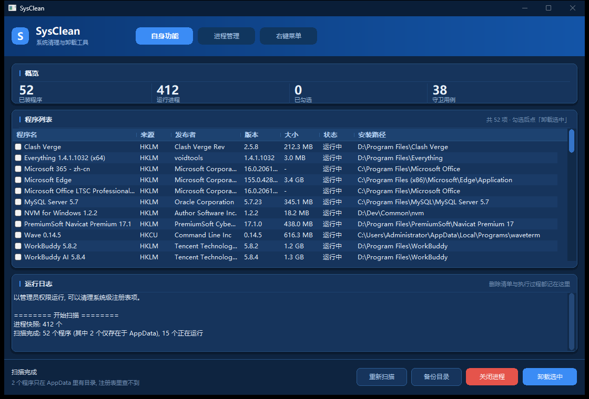
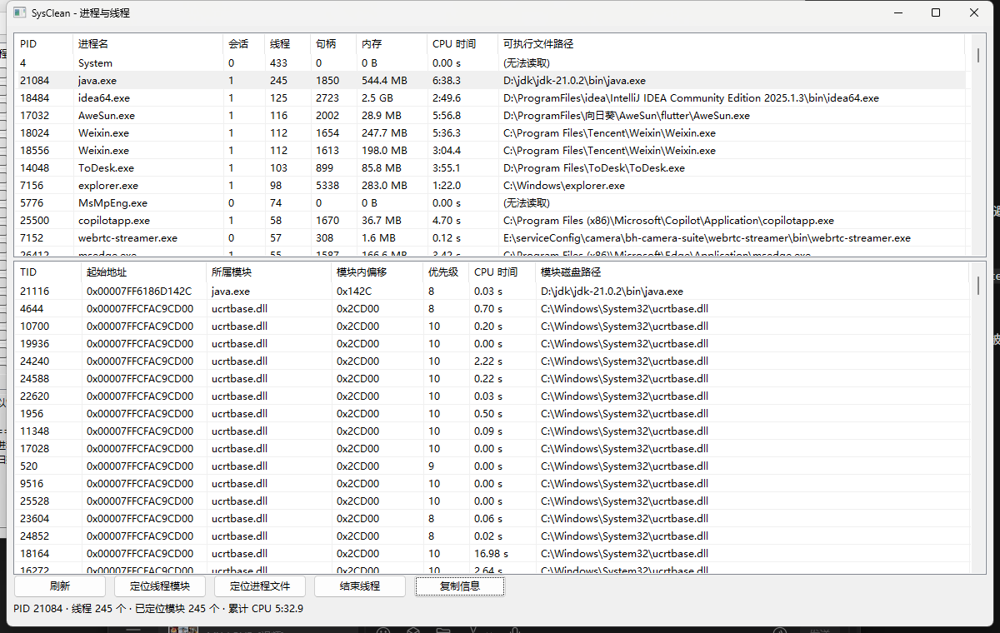
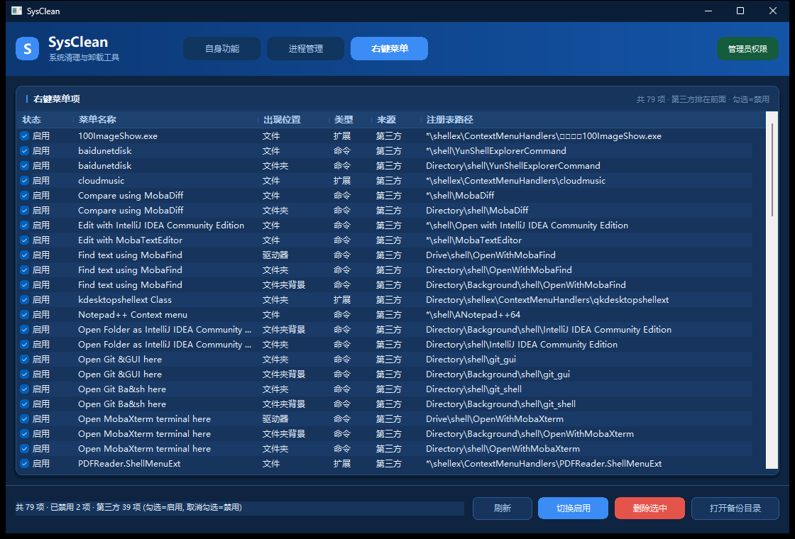

# SysClean

**一个 exe，双击就用。** 清理进程、强制卸载软件、定位线程、管理右键菜单。

纯 Win32 原生 C，静态链接，**不依赖 .NET、不依赖任何 VC 运行库**。Win7 / 8 / 8.1 / 10 / 11 直接跑。

```
单文件源码  3.9k 行 C  ·  产物 220 KB  ·  零外部依赖  ·  MIT
```



---

## 它解决什么问题

Windows 自带的"卸载程序"经常留下垃圾：

- 卸载完了，`Program Files` 目录还在
- `AppData\Local` 里几百兆数据没人管
- 注册表里卸载项、软件项、启动项、服务项全都留着
- 有些软件干脆不写卸载注册表项，控制面板里根本看不到

SysClean 做的是：**把选中的程序连根拔掉** —— 关进程 → 删安装目录 → 删 AppData 数据目录 → 清关联注册表，一条链走完。删不掉的文件会自动查出是谁占着、强杀、再删。

顺带还提供两个诊断工具：进程/线程视图（能定位每个线程落在硬盘上哪个 dll），以及右键菜单管理。

---

## 功能一览

| 功能 | 一句话 |
|---|---|
| **进程清理** | 一键终止当前用户会话内所有非系统进程，内核进程和 Session 0 的服务不动 |
| **程序列表** | 注册表 HKLM + HKCU + AppData 三路合并，扫出控制面板里看不到的软件 |
| **强制卸载** | 关进程 → 删安装目录 → 删数据目录 → 清注册表，被占用会强杀占用者 |
| **进程与线程** | 进程/线程两级视图，每个线程反查所属模块 + 模块磁盘路径，双击直接定位 |
| **右键菜单管理** | 列出所有右键菜单项，可临时禁用（可逆）或彻底删除（先备份） |

---

## 下载 & 运行

1. 去 [Releases](https://github.com/No2-king/sysclean/releases) 或直接下仓库里的 `dist/` 目录
2. 64 位系统（现在基本都是）用 **`dist/SysClean.exe`**
3. 老 Win7 32 位机器用 **`dist/SysClean_x86.exe`**
4. 双击运行，UAC 弹窗点「是」

> **必须给管理员权限。** 否则删不了 `Program Files` 和 `HKLM` 下的注册表。程序启动时会在日志里提示当前权限状态。

> 32 位版在 64 位系统上也能启动，但**线程定位会失效** —— 32 位进程读不到 64 位进程的模块表，地址还会被截断。程序会在信息栏明确提示换 64 位版。

### 第一次用建议这么做

```
1. 先点「重新扫描」，看看扫出了什么
2. 挑一个确实想删的、不重要的程序试一次
3. 看日志里打印的删除计划，确认路径对
4. 确认框点「是」
5. 去 backup\ 确认备份文件在
```

不要第一次就挑大型软件或者你不确定的东西。

---

## 目录结构

```
sysclean/
├── dist/                       编译好的成品
│   ├── SysClean.exe              64 位（推荐）
│   └── SysClean_x86.exe          32 位（仅老系统）
├── docs/                       截图
│   ├── preview.png               主窗口
│   ├── preview_threads.png       进程与线程
│   └── preview_menu.png          右键菜单管理
├── src/
│   ├── sysclean.c                全部源码，单文件
│   ├── app.manifest              提权 + 通用控件 v6 + DPI 感知
│   ├── build_exe.bat             一键编译（自动探测 VS / SDK）
│   ├── killall.bat               备选：纯进程清理批处理
│   └── tools/
│       ├── shot_all.py           重新生成 README 截图
│       └── verify_ui.py          不开截图检查界面结构
├── LICENSE
└── README.md
```

---

## 使用说明

主窗口 6 个按钮：

| 按钮 | 干什么 |
|---|---|
| **重新扫描** | 重读三处来源 + 刷新进程状态 |
| **一键关闭进程** | 终止当前用户会话内所有非系统进程 |
| **卸载选中项** | 见 [强制卸载](#强制卸载做了什么) |
| **打开备份目录** | 打开 `backup\`，按时间戳分的注册表备份 |
| **进程与线程** | 见 [进程与线程视图](#进程与线程视图) |
| **右键菜单** | 见 [右键菜单管理](#右键菜单管理) |

### 程序列表的三个来源

列表的「来源」列告诉你这条从哪扫出来的：

| 来源 | 含义 |
|---|---|
| `HKLM` | 机器级卸载注册表项，装在 Program Files 的程序 |
| `HKCU` | 用户级卸载注册表项，当前用户装的程序 |
| `AppData` | 只在 `%LOCALAPPDATA%` 下有目录，注册表里查不到 |
| `Roaming` | 只在 `%APPDATA%` 下有目录 |

**为什么要有 AppData 这一路**：Electron 类应用、便携版、用户级安装的程序（Discord、Postman、各种 `-updater`）经常不写卸载注册表项，控制面板里根本看不到，但磁盘上实实在在占着几百兆。只查注册表会漏掉它们。

AppData 扫描只认**目录里直接有 .exe** 的，并且过滤掉：

- 系统目录和缓存（`Microsoft`、`Packages`、`Temp`、`CrashDumps`、`Package Cache`…）
- 厂商容器（`Tencent`、`Google`、`Mozilla`…）—— 展开它们会误列一堆
- 更新器临时目录（`*-updater`）、版本化暂存目录（`*-2.96.0`）、解压临时目录（`TXV_5279`）
- 已经是别的程序数据目录的（避免同一软件出现两遍）

### 强制卸载做了什么

点「卸载选中项」，程序先**只扫描不动手**，把计划列出来给你看：

```
1. 微信  [HKLM]
   目录: C:\Program Files\Tencent\Weixin
   将删除
   注册表: 1 项

2. Everything 1.4.1.1032 (x64)  [HKLM]
   目录: D:\Program Files\Everything
   将删除
   数据: C:\Users\x\AppData\Local\Everything
   数据: C:\Users\x\AppData\Roaming\Everything
   服务: Everything
```

确认后才依次执行：

1. **关掉它的进程**（按 exe 路径匹配，不误杀别的）
2. **备份每一项注册表** → `backup\<时间戳>\<程序名>_N.hiv`
3. **删安装目录**（被占用会强杀占用进程，见下节）
4. **删 AppData 数据目录**（Local + Roaming，最多 4 个）
5. **删关联注册表**：
   - 卸载项（`...\CurrentVersion\Uninstall\<key>`）
   - 软件项（`SOFTWARE\<目录名>`，HKLM 64/32 + HKCU 三个位置）
   - 启动项（`...\Run` / `RunOnce` 里指向该程序的值，**只删那个值不删整个 Run 键**）
   - 服务（`SYSTEM\CurrentControlSet\Services\<name>`，ImagePath 落在安装目录下的）

完整清单在执行前就写进主窗口日志，确认框里只显示前 4 个的摘要。

### 文件被占用怎么办

删不掉的文件不会直接跳过，而是走这套流程：

```
1 项删不掉, 开始查占用进程
[强制结束] python.exe (PID 26564)
deleted=2 failed=0 killed=1 pendingReboot=0
```

**第一步：正常删。** 先按普通方式删，删不掉的记进待处理清单。

**第二步：查是谁占着。** 用 Windows 的 Restart Manager（`RmRegisterResources` / `RmGetList`）精确查出哪个进程打开了这些文件。这是系统自带的"谁占用了这个文件"接口，和资源管理器里"文件正在使用"弹窗用的是同一套机制。

**第三步：强杀占用进程。** 按 PID 直接 `TerminateProcess`，不管它的 exe 在不在安装目录下 —— 这样连注入到别的进程里的 dll 也能解开。

但有几种进程**不杀**：

| 进程 | 为什么 |
|---|---|
| `explorer.exe` | 杀了桌面会闪一下重启，用户会懵 |
| `dwm.exe` | 桌面合成器 |
| `MsMpEng.exe` / `NisSrv.exe` / `SecurityHealthService.exe` | 杀软，根本杀不掉 |
| `csrss` / `wininit` / `services` / `lsass` / `winlogon` / `smss` / `System` | 杀了直接蓝屏 |

这些持有文件时，直接进第四步。

**第四步：重试。** 杀掉后等 250ms 再删一遍，最多 3 轮。

**第五步：标记重启删除。** 还删不掉的，用 `MoveFileEx(..., MOVEFILE_DELAY_UNTIL_REBOOT)` 写进系统的重启删除队列，下次开机时由内核删除。界面上会告诉你标记了几项。

> **为什么不做"强制关闭句柄"**：有些解锁工具会用 `NtQuerySystemInformation` 找到文件句柄后强行 `CloseHandle`。这招能删掉文件，但会让目标进程拿着失效句柄继续跑，轻则报错重则崩溃 —— 把 explorer 的句柄关掉就是桌面直接挂。杀进程虽然粗暴，但至少是可控的。

---

## 进程与线程视图



点「进程与线程」打开，上下两个列表联动。

**上半：所有进程**（按线程数从多到少排，一眼看出谁在狂开线程）

`PID · 进程名 · 会话 · 线程数 · 句柄数 · 内存 · 累计 CPU · 可执行文件完整路径`

**下半：选中进程的全部线程**

| 列 | 含义 |
|---|---|
| TID | 线程 ID |
| 起始地址 | 线程的 `Win32StartAddress`（这个线程是从哪段代码开始跑的） |
| 所属模块 | 这个地址落在哪个 exe / dll 里 |
| 模块内偏移 | 模块基址 + 偏移，如 `ucrtbase.dll + 0x2CD00` |
| 优先级 | 基础优先级 |
| CPU 时间 | 该线程累计内核 + 用户态时间 |
| 模块磁盘路径 | **这个 dll 在硬盘上的完整路径** |

**怎么"定位"**

- **双击线程** → 打开资源管理器，直接选中那个 dll 并高亮
- **双击进程** → 选中它的 exe
- **复制信息** → 复制 `TID 1234  ucrtbase.dll+0x2CD00  C:\Windows\System32\ucrtbase.dll`
- **结束线程** → `TerminateThread`，见下方警告

底部信息栏实时显示：`PID 21084 · 线程 245 个 · 已定位模块 245 个 · 累计 CPU 5.32s`。

### 定位的边界在哪

- **能定位**：绝大多数线程的起始地址都在某个模块的地址范围内，实测可访问进程的定位率接近 100%
- **不能定位**：JIT 动态生成的代码（.NET、Java、V8 的即时编译线程），地址不属于任何磁盘文件
- **读不到**：`System` (PID 4)、`MsMpEng`、`Memory Compression` 这类受保护进程，模块表拒绝访问
- **没有调用栈**：本工具给的是"线程属于哪个文件"，不是"线程正在执行哪个函数"

---

## 右键菜单管理



列表把系统里所有右键菜单项拉出来，一行一项，**第三方排前面，系统自带的排后面**。

| 列 | 含义 |
|---|---|
| 状态 | `启用` / `已禁用` |
| 菜单名称 | 菜单上显示的字。`@shell32.dll,-8506` 这种间接字符串会解析成真实文字（「在此处打开命令窗口」） |
| 出现位置 | 文件 / 文件夹 / 文件夹背景 / 驱动器 / 桌面 |
| 类型 | `命令`（shell verb，注册表里写命令行）/ `扩展`（shellex，注册表里写 CLSID，指向一个 dll） |
| 来源 | 系统 / 第三方 |
| 注册表路径 | `HKEY_CLASSES_ROOT` 下的完整路径，想自己动手改就照这个找 |

### 扫的是哪几个位置

```
*\shell                                          文件和所有类型
*\shellex\ContextMenuHandlers
Directory\shell                                  文件夹
Directory\shellex\ContextMenuHandlers
Directory\Background\shell                       文件夹空白处
Directory\Background\shellex\ContextMenuHandlers
Drive\shell                                      驱动器
DesktopBackground\Shell                          桌面空白处
```

`HKCR` 是 `HKLM\Software\Classes` 和 `HKCU\Software\Classes` 合并出来的视图，所以两个位置的项都能扫到。

### 禁用（勾选框）

取消勾选 = 禁用。**两种类型的做法不一样，但都是微软认的官方方式，且完全可逆**：

**命令型（shell verb）** —— 写 `LegacyDisable` 值：

```
HKCR\Directory\shell\cmd
  LegacyDisable = ""        ← 加这个值, 资源管理器就不显示它了
```

`LegacyDisable` 是 shell 从 XP 时代就支持的隐藏标志，比那些"改名加个减号前缀"的野路子可靠得多（`-` 前缀那种老写法本程序会直接跳过不列）。

**扩展型（shellex）** —— 把 CLSID 挪到备份值：

```
HKCR\*\shellex\ContextMenuHandlers\EPP
  (默认)          = "{09A47860-...}"     ← 清空
  SysCleanBackup  = "{09A47860-...}"     ← 挪到这里
```

清空默认值，shell 就找不到这个处理器了。恢复时把 `SysCleanBackup` 抄回默认值再删掉备份值。

> **两种方式都不删任何东西**，注册表结构原封不动，随时切回来。禁用后**重新打开一次右键菜单**就能看到效果，不用重启资源管理器。

### 彻底删除

选中一行点「删除选中」，会先弹确认框，显示要删的完整路径，并提醒你"如果只是想临时关掉，用勾选框就够了"。

确认后：

1. **备份**：`RegSaveKeyEx` 把整棵子树存成 `backup\menu\<时间戳>\<菜单名>.hiv`
2. **删除**：`RegDeleteTree` 递归删掉整个键（含 `command` 子键）
3. **刷新**：重新扫描，列表里就没了

删除失败（权限不足）会明确告诉你用管理员身份运行。

### 为什么"禁用"和"删除"要分两个动作

大部分人的需求是"这个菜单太碍眼，别显示"，而不是"把这个软件彻底拆了"。删注册表是不可逆的（虽然备份了，恢复要命令行），禁用是可逆的且零风险。**默认引导用户用禁用**，删除只留给确实想清理残留的场景。

### 怎么恢复

| 场景 | 做法 |
|---|---|
| 只是禁用了 | 再勾上就行 |
| 删掉了 | `reg restore "HKCR\..." backup\menu\<时间戳>\xxx.hiv` |
| 想批量看历史备份 | 点「打开备份目录」，进 `backup\menu\` |

---

## 安全设计：为什么它不会把系统删坏

强制卸载最容易出事，所以每一层删除都有守卫。**三套守卫共 38 条用例，`/selftest` 可随时验证，当前全过。**

### 1. 安装目录守卫（16 条用例）

- 盘符根、`C:\Windows`、`C:\Program Files`、`C:\ProgramData`、`C:\Users` 本身 → 拒绝
- `C:\Windows\`、`Common Files`、`ProgramData\Microsoft`、`Package Cache`、`$Recycle.Bin`、`Recovery` 整棵树 → 拒绝
- 目录名是通用容器（`Programs`、`AppData`、`Local`、`Roaming`、`Temp`、`System32`…）→ 拒绝
- 路径短于 10 字符、含 `..`、UNC 路径 → 拒绝
- 正斜杠会先规范化成反斜杠，防止 `C:/Windows/System32` 绕过检查

### 2. 数据目录守卫（8 条用例）

- 只允许删 `%LOCALAPPDATA%` / `%APPDATA%` **之下**的目录
- AppData 本身、名字相近的兄弟目录（`AppData\LocalX`）→ 拒绝
- **重解析点（junction / 符号链接）一律拒绝** —— `AppData\Local\Application Data` 是自我指向的 junction，删它会穿透到整个 Local
- 数据目录名只在**精确匹配**时才认，不做模糊搜索；最后一级是通用名（`bin`/`app`/`Application`）才往上一层

### 3. 注册表路径守卫（14 条用例）

- `SOFTWARE`、`SOFTWARE\Microsoft`、`SOFTWARE\Classes`、`SOFTWARE\Policies`、`SOFTWARE\Wow6432Node`、`SYSTEM`、`SYSTEM\CurrentControlSet\Services` 这些共享容器 → 拒绝
- 只删**键名与程序目录名完全相等**的键，绝不退到厂商级
  > 这条是硬规则：`SOFTWARE\Tencent` 是全家桶容器，删了 QQ、企业微信、微信的配置一起没
- 启动项只删匹配的那个**值**，不删整个 `Run` 键

### 4. 内核进程白名单

`smss` `csrss` `wininit` `services` `lsass` `winlogon` `svchost` 杀掉直接蓝屏，硬编码在白名单里，任何模式下都不碰。

### 5. 只清用户会话

默认只处理 Session ≥ 1 的进程。Session 0 跑的是系统服务，一个都不碰。

### 6. 注册表先备份

每一项删除之前都 `RegSaveKeyEx` 备份成 `.hiv`。备份失败会告警但仍继续。

---

## 风险，读一遍

- **删除不可逆**。文件直接删，不进回收站。
- **会强制结束占用文件的进程**。卸载时会先杀 exe 在安装目录下的进程，删不动时再杀持有文件的进程（explorer、杀软和内核进程除外）。**没保存的东西会丢。**
- **备份是 `.hiv` 格式**，不是 `.reg`。恢复要命令行：`reg restore "HKLM\SOFTWARE\..." backup\xxx.hiv`。
- **同一目录被多个程序共用时**，卸载其中一个会删掉另一个的文件。界面上会出现两行指向同一路径，删之前看清楚。
- **服务项删除后需要重启**才能彻底消失（服务进程还在内存里跑着）。
- **标记重启删除的文件要重启才消失**，卸载完成时会告诉你标记了几项。
- **AppData 条目删的是数据目录**。如果那是你存了几年配置的地方，删了就没了。
- **结束线程是危险操作**。`TerminateThread` 不会让目标线程释放锁和内存，目标进程可能卡死。
- **杀软可能误报**。批量终止进程 + 删目录 + 删注册表，行为特征和恶意软件重合。源码全在 `src/sysclean.c`，没有网络请求、没有自启动、没有隐藏行为 —— 可以自己审计或者自己编译。

**不要在有重要数据的生产机上第一次试这个工具。**

---

## 从源码构建

### 需要什么

- Visual Studio 2019 / 2022 / 2026，安装时勾选 **「使用 C++ 的桌面开发」**
- Windows 10 或 11 SDK

不需要 CMake，不需要 vcpkg，不需要任何第三方库。

### 怎么编

```bat
cd src
build_exe.bat
```

脚本会自动通过 `vswhere` 找到 Visual Studio、取最新的 MSVC 工具集和 Windows SDK 版本，然后产出：

```
..\dist\SysClean.exe        (64 位)
..\dist\SysClean_x86.exe    (32 位)
```

### 手动编译（不想用脚本）

```bat
cl /MT /O2 /utf-8 sysclean.c /link /SUBSYSTEM:WINDOWS ^
   user32.lib advapi32.lib comctl32.lib shlwapi.lib gdi32.lib shell32.lib psapi.lib ^
   /MANIFEST:EMBED /MANIFESTINPUT:app.manifest ^
   /MANIFESTUAC:"level='requireAdministrator' uiAccess='false'"
```

`/MT` 是关键 —— 静态链接 CRT，目标机上不需要 VC 运行库。

---

## 自检模式

程序带几个命令行开关，只读或隔离运行，用来验证功能没坏。正式使用用不到。

| 开关 | 作用 | 输出 |
|---|---|---|
| `/selftest` | 跑 38 条路径守卫用例 | `selftest.txt` |
| `/threadtest` | 枚举全部进程和线程，验证地址反查 | `threadtest.txt` |
| `/menutest` | 扫描全部右键菜单项 | `menutest.txt` |
| `/menutoggle "<HKCR子路径>"` | 对一个注册表项做 禁用→校验→还原→校验 round-trip | `menutoggle.txt` |
| `/testdelete "<目录>" [/nokill]` | 在指定临时目录上跑完整删除流程 | `testdelete.txt` |

`/testdelete` 请**只指向你自己建的临时目录**，别指向真实程序目录。

界面回归：

```bash
python src/tools/verify_ui.py
# 检查按钮数量、列表行数、表头列数、状态栏文字, 输出 PASS / FAIL
```

---

## 已知限制

- **只处理当前用户会话**。别的用户登录着的进程动不了。
- **不处理 MSIX / Store 应用**。它们走 `WindowsApps` + AppX 注册表，机制完全不同。
- **不处理驱动**。`SYSTEM\CurrentControlSet\Services` 下 `Type=1`（内核驱动）的项只做关联展示，不删。
- **不做"安装监控"**。它是事后扫描，不是安装时记录 —— 所以扫不到某些软件留下的、名字完全无关的残留。
- **`.hiv` 恢复要命令行**，没有做 GUI 还原。
- **没有多语言**。界面全中文。

---

## 实现笔记（踩过的坑）

写这个工具踩了一堆 Win32 的坑，记下来省得别人再踩一遍。

**1. `tasklist /fo csv` 的列顺序**是 `名称,PID,会话名,会话#,内存`，会话号是**第 4 列**不是第 5 列。取错列会让 Session 过滤整个静默失效。

**2. `\\?\` 长路径前缀不接受正斜杠，也不接受连续分隔符。** 必须先规范化再拼前缀。

**3. `PROCESS_MEMORY_COUNTERS_EX` 里没有 `HandleCount`。** 句柄数要单独调 `GetProcessHandleCount`，且需要 `PROCESS_QUERY_INFORMATION`（不是 `LIMITED`）。

**4. 32 位程序在 64 位系统上读不到 64 位进程的模块表**，`NtQueryInformationThread` 返回的地址也会被截断。这是 WOW64 的硬限制。

**5. 线程起始地址没有官方 API。** 只能走 `NtQueryInformationThread(ThreadQuerySetWin32StartAddress)`，且函数指针必须在任何分支之前初始化，否则静默返回 0。

**6. 目录名往上找一层是个陷阱。** 初版为了兼容 `...\Chrome\Application` 这种结构，会从安装目录逐级往上试。结果 `C:\Program Files\Tencent\Weixin` 退到了 `Tencent`，把 `AppData\Local\Tencent` 当成微信的数据目录，把 `SOFTWARE\Tencent` 当成微信的注册表项 —— 一删就是全家桶。正确做法是：**只有最后一级是通用名（`bin`/`app`/`Application`）才往上退，拿到具体名字立刻停**。

**7. `%LOCALAPPDATA%\Application Data` 是指向自己的 junction。** 删它会穿透到整个 Local 目录。所有数据目录在删之前必须检查 `FILE_ATTRIBUTE_REPARSE_POINT`。

**8. `MoveFileEx` 的 `MOVEFILE_DELAY_UNTIL_REBOOT` 不认 `\\?\` 前缀。** 内部路径存的是 `\??\D:\...` 这种格式，传 `\\?\D:\...` 会写进一个无效条目。待删除清单里必须存普通路径。

**9. Restart Manager 对目录无效。** `RmRegisterResources` 只接受文件路径，传目录进去查不到占用者。目录被当工作目录时只能靠 `MoveFileEx` 兜底。

**10. 右键菜单的名称大多是间接字符串**，直接读注册表只会拿到 `@shell32.dll,-8506`。必须调 `SHLoadIndirectString`（`shlwapi.h` / `shlwapi.lib`）解析。不解析的话列表里全是 dll 名，用户根本不知道自己关的是哪个菜单。

**11. 判断"系统菜单"不能只看命令行。** 大量系统 verb 的 `command` 是空的（`pintohome`、`UpdateEncryptionSettings`、`Display`、`Personalize`），只看 cmd 会把 40 个系统项全判成第三方。得同时看 `MUIVerb` 里 `@` 后面的资源路径，落在 `\Windows\`、`%SystemRoot%`、`Windows Defender`、`Common Files\Microsoft Shared` 下的都算系统。

**12. 老式禁用写法是给键名加 `-` 前缀**（`HKCR\*\shell\-open`），这不是官方做法，而且会让键名彻底变形。扫描时遇到 `-` 开头的直接跳过不列，禁用一律走 `LegacyDisable`。

---

## 实测记录

在一台 359 进程、53 个已安装程序的机器上跑过：

- **三路扫描**：HKLM 64/32 位视图 + HKCU + AppData，去重合并后 53 个（其中 3 个只存在于 AppData）
- **数据目录匹配**：15 个程序关联到了 AppData 目录，包括 `NetEase\CloudMusic`（厂商目录 + 产品目录的精确匹配）
- **注册表关联**：7 个服务、28 个启动项、7 个软件项被正确关联到对应程序
- **路径守卫**：安装目录 16/16、数据目录 8/8、注册表 14/14，全部通过
- **删除逻辑**：只读文件、含空格目录、空目录、356 字符超长路径，全部删干净
- **占用强杀**：构造了一个不共享 DELETE 的占用进程，Restart Manager 精确识别到 PID，强杀后 2 个文件全部删除、目录清空
- **重启删除兜底**：跳过强杀时，被占用的文件正确标记进 `PendingFileRenameOperations`，`failed=0`
- **线程定位**：java.exe 245 个线程全部反查到模块（`java.exe+0x142C`、`ucrtbase.dll+0x2CD00` 等）
- **右键菜单扫描**：8 个位置共扫出 79 项（第三方 39 / 系统 40，已禁用 2 项）。`@shell32.dll,-8506` 这类间接字符串正确解析成中文菜单名，系统项自动排到列表末尾
- **右键菜单开关**：命令型和扩展型各构造一个测试键做 round-trip，`LegacyDisable` 写入→删除、`SysCleanBackup` 保存→还原，4 步全部 OK

---

## 许可

[MIT](LICENSE)

这个程序会终止进程、删除文件、删注册表，属于**不可逆操作**。作者不对使用造成的数据丢失或系统损坏负责。用之前先看上面的「风险」章节。
